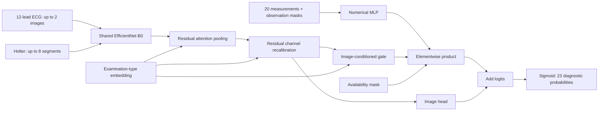

# TAG-ECGNet

**Type-Aware Gated ECG Network** for report-level, 23-category **multi-label** ECG diagnosis.

The final model shares an EfficientNet-B0 encoder across standard 12-lead ECG
reports and Holter reports. Examination-conditioned residual attention pooling
and channel recalibration aggregate image features; an image-conditioned gate
adds structured measurement logits. Outputs use **sigmoid independently per
category**, because several diagnoses can coexist in one report.

This repository packages the final experimental network and five CNN references.
It contains no clinical images, patient/report manifests, trained weights or
individual predictions. Example records and tests are synthetic. Results are
aggregate experimental measurements, not a claim of clinical deployment readiness.

## Architecture



The default model has **4,408,308 parameters**. The numerical gate starts near
0.05; whole-metadata dropout is 0.30. When all measurements are missing, the
numerical contribution is zero. There is no report-text encoder.

## Installation

Use Python 3.11 (Python 3.10 is also supported by the package). From this repository:

```bash
conda env create -f environment.yml
conda activate tag-ecgnet
pip install -e .
python -m unittest discover -s tests -v
```

Alternatively create your own Python 3.11 environment and run `pip install -e .`.
PyTorch 2.1.1 and torchvision 0.16.1 match the training environment; the original
GPU experiments used CUDA 12.1 wheels. Select a PyTorch installation compatible
with your hardware. CPU mode supports tests and inference; full training is
intended for a CUDA GPU. ImageNet weights download on first training use; use
`--no-pretrained` only for offline debugging, not for reproducing the reported protocol.

## Data interface

Provide private, pre-curated JSONL files, one report per line:

```text
data/manifests/
  train.jsonl
  val.jsonl
  test.jsonl        # optional
  external.jsonl    # optional
```

Images are loaded relative to `--image-root`. Each record has:

```json
{
  "report_id": "SYNTHETIC_REPORT",
  "type": "standard_ecg",
  "images": ["waveforms/example.png"],
  "values": [null, null, null, null, null, null, null, null, null, null,
             null, null, null, null, null, null, null, null, null, null],
  "labels": [0,0,0,0,0,0,0,0,0,0,0,0,0,0,0,0,0,0,0,0,0,0,0],
  "label_mask": [0,0,0,0,0,0,0,0,0,0,0,0,0,0,0,0,0,0,0,0,0,0,0]
}
```

`type` is `standard_ecg` or `holter`. `labels` and `label_mask` follow the exact
order in [configs/labels.json](configs/labels.json). A mask of 1 denotes an
observed label; 0 excludes that report/category from loss and evaluation. The
example is intentionally unlabeled, and cannot train a useful classifier.
Use JSON `null` for missing measurements. See [docs/data.md](docs/data.md) for the
canonical feature order, annotation policy and split requirements.

**Reuse the original fixed manifests to reproduce the study.** This release
does not reconstruct labels from diagnostic text or generate new patient splits.
No private manifests or raw data are redistributed. Data access must be obtained
separately. Numerical scaling is fitted on training records only.

## Train

```bash
python -m tag_ecgnet.train \
  --manifest-dir data/manifests \
  --image-root data/images \
  --cache-dir cache/waveforms \
  --output-dir runs/tag_ecgnet_s42 \
  --model tag_ecgnet --device cuda
```

Defaults match the final training budget: 8 epochs, report batch size 2,
gradient accumulation 12, seed 42, AdamW backbone learning rate 1e-4 and other
parameters 3e-4, weight decay 0.01, cosine scheduling, frozen BN statistics,
and validation patience 3. Checkpoint selection averages the standard ECG and
Holter validation macro average precision. Thresholds are fitted on validation
data, then transferred unchanged to evaluation cohorts.

The output directory contains `best.pt`, `last.pt`, `config.json`, `scaler.json`,
`history.json`, `thresholds.json`, metrics and per-report predictions. Treat run
outputs as private. An existing nonempty directory requires `--resume`; resume
requires the same configuration, label order and manifests.

Model names accepted by the same training command:

| Argument | Model |
|---|---|
| `tag_ecgnet` | Final TAG-ECGNet with gated numerical fusion |
| `tag_ecgnet_image_only` | Type-conditioned aggregation without numerical fusion |
| `efficientnet_b0` | Image-only EfficientNet-B0, mean logits |
| `resnet18` | Image-only ResNet18, mean logits |
| `mobilenet_v2` | Image-only MobileNetV2, mean logits |
| `shufflenet_v2_x1_0` | Image-only ShuffleNetV2 ×1.0, mean logits |
| `squeezenet1_1` | Image-only SqueezeNet1.1, mean logits |

Measurement-only logistic regression:

```bash
python -m tag_ecgnet.tabular --manifest-dir data/manifests \
  --output-dir runs/measurement_only_s42
```

## Evaluate and predict

```bash
python -m tag_ecgnet.evaluate \
  --checkpoint runs/tag_ecgnet_s42/best.pt \
  --manifest data/manifests/external.jsonl \
  --image-root data/images --output-dir runs/external_eval --device cuda

python -m tag_ecgnet.predict \
  --checkpoint runs/tag_ecgnet_s42/best.pt \
  --manifest data/new_reports.jsonl \
  --image-root data/images --output-dir runs/prediction --device cpu
```

Prediction records may omit `labels` and `label_mask`; missing `values` defaults
to all missing. Neither evaluation nor prediction refits preprocessing or thresholds.
Outputs include per-class probabilities, predicted labels and selected-image
attention weights. Labels can co-occur, and probabilities need not sum to one.

## Existing research weights

The public model class is `tag_ecgnet.model.TAGECGNet`. Internal parameter names
are preserved from the final experimental implementation, enabling strict
loading of existing network weights. Convert an original fusion run directory
into a self-contained release checkpoint before evaluation:

```bash
python -m tag_ecgnet.convert_checkpoint \
  --legacy-run /path/to/original/fusion_run \
  --output checkpoints/tag_ecgnet_s42.pt
```

The original directory must contain `best.pt`, `scaler.json` and `thresholds.json`.
Only load trusted checkpoints. The converter requires exact architecture compatibility.
The historical run name `efficientnet_fusion_v2_s42` maps to `TAG-ECGNet`;
`efficientnet_typeaware_v2_s42` maps to `TAG-ECGNet without numerical fusion`
(convert the latter with `--model tag_ecgnet_image_only`).

## Recorded results

Values are **macro AUROC / macro average precision** (reported as AUPRC).
These are the completed original experiments, not fresh measurements from this
portable release. Full aggregate metrics are in [results/benchmark_summary.json](results/benchmark_summary.json).

| Model | Internal 12-lead ECG | Internal Holter | External 12-lead ECG |
|---|---:|---:|---:|
| Measurement-only logistic regression | 0.8760 / 0.4691 | 0.7238 / 0.5162 | 0.7535 / 0.3018 |
| ResNet18 | 0.9269 / 0.5883 | 0.9158 / 0.7171 | 0.7651 / 0.3163 |
| MobileNetV2 | 0.9171 / 0.5522 | 0.8942 / 0.6918 | 0.8335 / 0.3580 |
| ShuffleNetV2 ×1.0 | 0.8896 / 0.4972 | 0.8550 / 0.6211 | 0.7143 / 0.2534 |
| SqueezeNet1.1 | 0.8998 / 0.5033 | 0.8584 / 0.6458 | 0.6794 / 0.2146 |
| EfficientNet-B0 | 0.9235 / 0.5852 | 0.9277 / 0.7441 | 0.8591 / 0.4162 |
| TAG-ECGNet without numerical fusion | 0.9212 / 0.5775 | 0.9270 / 0.7453 | 0.8343 / 0.3790 |
| **TAG-ECGNet** | **0.9374 / 0.6206** | **0.9250 / 0.7455** | **0.8709 / 0.4121** |

Anzhen train/validation/test sizes are 11,198 / 1,351 / 1,469 reports; internal test subsets contain 980 standard ECG and 489 Holter reports. The external cohort contains 4,263 standard ECG reports. Metrics cover 20, 14 and 19 eligible categories, respectively. Do not compare examination types as identical tasks.

TAG-ECGNet
improved standard ECG AUROC, but Holter gains were small and external AUPRC did
not exceed the original B0 baseline. The numerical-input advantage is not a
pure architecture-only comparison against image-only CNNs.

## Release scope

Release checks are documented in [docs/validation.md](docs/validation.md).

Source code for **TAG-ECGNet** is hosted at
[github.com/qutaiping/TAG-ECGNet](https://github.com/qutaiping/TAG-ECGNet). A software license and publication DOI
have not been specified; no license or citation metadata is fabricated here.
Early frozen-ResNet pilot pipelines and institution-specific PDF/label extraction
scripts are not part of the final network release.
